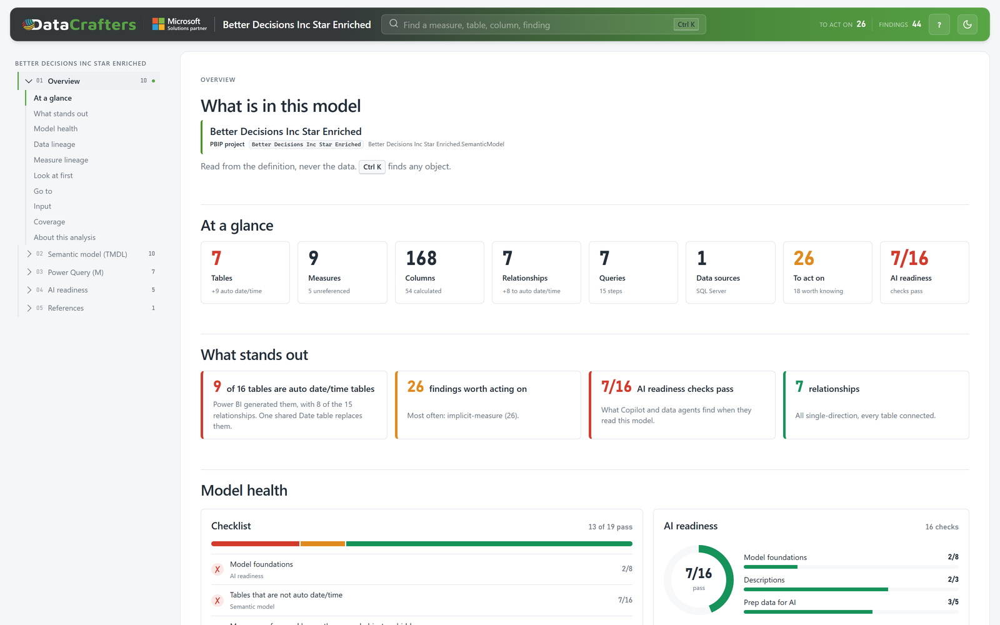
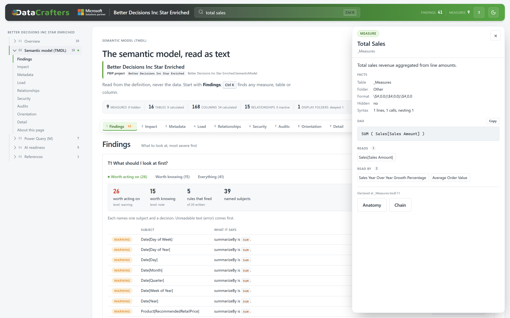

#  Crafty's Fabric Skills

<!-- BG&C: positioning, tagline and intro to be finalised. Working copy below. -->

Agent skills for Microsoft Fabric and Power BI, built from how we deliver for clients. Free under Apache-2.0.

## All skills

Each skill is its own plugin, so you install only the ones you need. More are on the way.

| Skill | What it does | Zip |
|---|---|---|
| [semantic-model-analyzer](plugins/semantic-model-analyzer/skills/semantic-model-analyzer) | Reads a Power BI semantic model or its Power Query as text and reports on it. | [Download](https://github.com/DataCraftersLab/craftys-fabric-skills/releases?q=semantic-model-analyzer&expanded=true) |

To add the whole marketplace in Claude Code:

```
/plugin marketplace add DataCraftersLab/craftys-fabric-skills
```

A downloaded zip does not update itself. The install commands do.

## Semantic Model Analyzer

**Ask your AI agent what is in your Power BI model. No Power BI Desktop, no XMLA connection, no Fabric access.**

Point it at a PBIP project, a folder of TMDL files, or a Power Query paste, and ask:

- "Which measures have no description or no format string?"
- "What breaks if I change `Total Sales`?"
- "What changed between last month's model and this one?"
- "Are there inactive, bi-directional or many-to-many relationships?"
- "Where does this query's SQL actually run, and where does folding break?"
- "Give me an HTML report I can hand to the team."





### What you get

- **Answers from the definition.** Measures, columns, tables, relationships, roles, calculation groups, partitions and storage mode, DAX dependency chains, query steps, custom functions, connectors and native SQL.
- **Findings with a named subject.** Thirty rules (twenty for the semantic model, ten for Power Query), each pointing at the file and line, such as unreferenced measures, deep dependency chains, implicit measures and relationship loops.
- **A report you can share.** Self-contained HTML pages that open without a server and make no network requests.
- **Model diffs.** What changed between two versions, in model terms rather than a text diff.

### Why it is safe to run on client models

It reads the model's text only. It never connects to the model and never sees a row of data. It runs locally on Python 3.9 or later with no packages to install.

### Install

Claude.ai and Claude Desktop: download the zip from [Releases](https://github.com/DataCraftersLab/craftys-fabric-skills/releases?q=semantic-model-analyzer&expanded=true) and upload it under Settings, Capabilities, Skills.

Claude Code:

```
/plugin install semantic-model-analyzer --marketplace DataCraftersLab/craftys-fabric-skills
```

Codex, Copilot, Cursor, Gemini CLI and other agents:

```
npx skills add DataCraftersLab/craftys-fabric-skills --skill semantic-model-analyzer
```

Full documentation: [the skill's README](plugins/semantic-model-analyzer/skills/semantic-model-analyzer/README.md).

## Contributing

Bug reports and questions are welcome. See [CONTRIBUTING.md](CONTRIBUTING.md).

## Licence

Apache-2.0. See [LICENSE](LICENSE).
